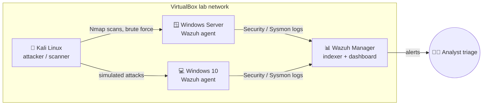

# 🛡️ SOC Home Lab: Wazuh SIEM, Kali Linux & Windows Server

A self-hosted security operations lab I built to practise what a Tier-1 SOC analyst does every day: **collect logs, detect suspicious activity, triage alerts and write it up.**

## What's in this repo

| Folder | Contents |
|---|---|
| [`docs/01-lab-architecture.md`](docs/01-lab-architecture.md) | VMs, networking and design decisions |
| [`docs/02-wazuh-setup.md`](docs/02-wazuh-setup.md) | Installing the Wazuh manager and agents, enabling the right Windows logs |
| [`docs/03-nmap-methodology.md`](docs/03-nmap-methodology.md) | How I scan and enumerate lab hosts, and how I write up findings |
| [`configs/local_rules.xml`](configs/local_rules.xml) | Custom Wazuh rules (SSH brute force, fail-then-succeed, RDP brute force), mapped to MITRE ATT&CK |
| [`findings/`](findings/) | Investigation and scan write-ups, one per exercise |
| [`screenshots/`](screenshots/) | Dashboard and alert evidence |

## Skills practised

- **SIEM:** Wazuh agent deployment, log collection, custom rules, alert triage
- **Network security:** Nmap host discovery, service/version enumeration, interpreting results
- **Windows logging:** Security events 4624/4625/4688/4720, audit policy
- **Frameworks:** MITRE ATT&CK mapping (T1046, T1110, T1078), incident write-ups following NIST SP 800-61 phases
- **Analysis:** the companion [log-analysis-toolkit](https://github.com/chahat-24/log-analysis-toolkit) repo turns the same detections into tested Python and SQL

## Exercises

| # | Exercise | ATT&CK | Write-up |
|---|---|---|---|
| 1 | Nmap discovery and service enumeration of lab hosts | T1046 | [findings/01-nmap-enumeration.md](findings/01-nmap-enumeration.md) |
| 2 | SSH / RDP brute force from Kali, detected in Wazuh | T1110 | [findings/02-brute-force-detection.md](findings/02-brute-force-detection.md) |
| 3 | New local admin account created on Windows | T1136.001 | *planned* |
| 4 | Suspicious PowerShell execution (Sysmon) | T1059.001 | *planned* |

> ⚠️ All activity takes place on isolated VMs I own. Nothing here targets real systems.

---
**Chahat** · MSc Cybersecurity (Commendation) · [LinkedIn](https://www.linkedin.com/in/chahat2410) · Studying for CompTIA Security+ (Feb 2027)
